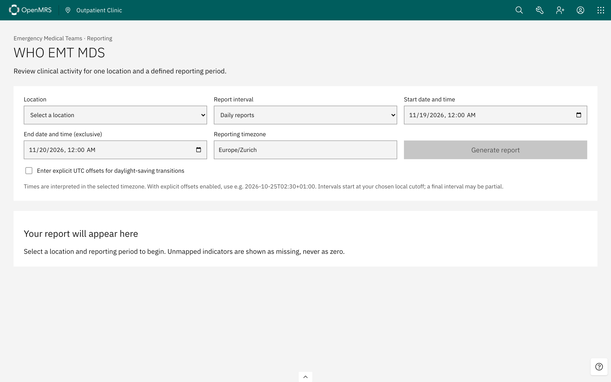
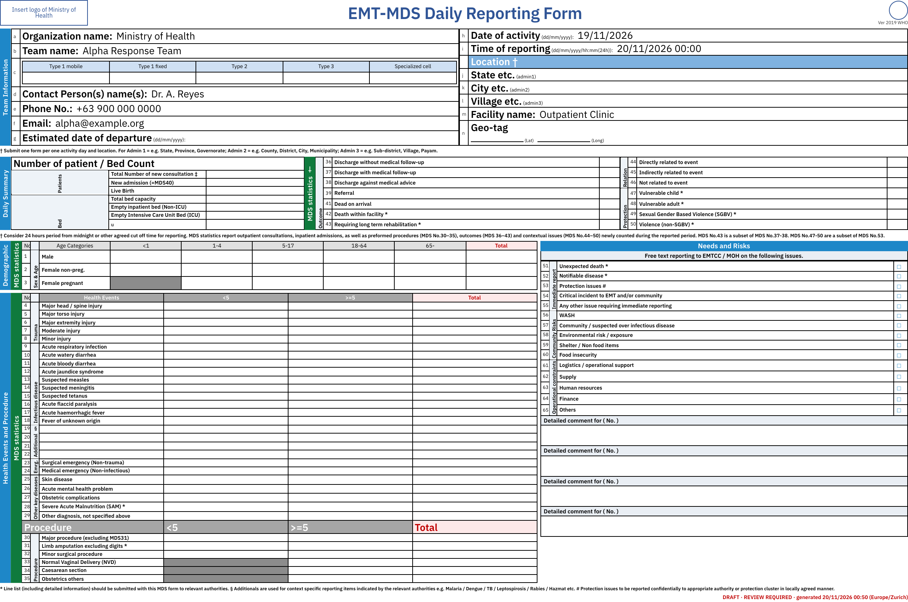

# WHO EMT MDS for OpenMRS 3

An O3 app-menu module and OpenMRS backend module for location-specific daily reports and weekly summaries. Select a location, start/end date and time, and an IANA timezone. Review indicator counts and missing mappings, add team information, bed snapshots and needs/risks comments, then download a review CSV or print to PDF.

## Current status

The backend module and the frontend app are both installed and verified end to end on a local
OpenMRS 3 reference-application stack: the app renders at `/openmrs/spa/who-mds`, the location list
loads from the backend servlet, and generating a report returns populated indicator tables.

**Clinical mapping validation remains pending.** All output is marked DRAFT. No clinical mappings are
guessed, and no forms or concepts are created automatically. Unconfigured, invalid or unreviewed
mappings remain missing rather than becoming zero.

The local frontend registry reports Core 11.0.0. The backend compiles against OpenMRS Platform 2.7.0
and has been smoke-tested on Platform 2.8.10 (Java 21, UTC).

## Screenshots

Report filters, before a location is selected:



A generated draft report, with team information and per-indicator counts:


The printable output, which reproduces the official WHO EMT-MDS Daily Reporting Form (Ver 2019).
One page is produced per reporting interval:



## Install locally

Built files:

- `backend/target/whomds-0.1.0.omod`
- `frontend/dist/` (the entire directory, including JS chunks and CSS)

From this repository, with the supplied Compose stack running:

```sh
bash scripts/install-local.sh --frontend-only
```

The `--frontend-only` command installs the remaining menu integration without restarting the backend. Omit that flag for a full installation.

The full installer backs up the frontend import map and route registry under `.local-install/`, adds this app while preserving other apps, copies the OMOD into the persisted backend modules directory, and **restarts the backend**. It does not recreate containers or modify the database directly.

The installer resolves containers with `docker compose ps`, which derives its project name from the
working directory. If the stack was started from a different directory, pass its project name:

```sh
COMPOSE_PROJECT_NAME=<project> bash scripts/install-local.sh --frontend-only
```

Two caching behaviours in the reference-application frontend image are handled by the installer, and
are worth knowing if you register this app by hand:

- nginx serves SPA asset paths with a one-year immutable `Cache-Control`. The installer therefore
  copies the bundle into a directory named from a hash of the build output, so each install gets a
  URL no stale cache entry can shadow.
- nginx is built with `gzip_static`/`brotli_static` and the image ships pre-compressed `.gz`/`.br`
  copies of `importmap.json` and `routes.registry.json`. Rewriting only the plaintext files leaves
  every browser reading the original registry while `curl` without `Accept-Encoding` sees the new
  one. The installer regenerates the `.gz` variants and removes the stale `.br` files.

Wait for OpenMRS to become healthy, verify the module is started in module administration, sign in and reload the frontend. **WHO EMT MDS** should appear in the app menu at `/openmrs/spa/who-mds`.

Frontend files copied into the container layer are lost on container recreation; rerun the installer afterward. For a durable distribution, include this frontend package in distro assembly and the OMOD in its backend image.

To undo frontend registration, copy the backed-up JSON files from `.local-install/<timestamp>/original/` back to `/usr/share/nginx/html/` in the frontend container. Remove the WHO MDS module through OpenMRS module administration. This module does not write patient data.

## Permissions

Reporting users need `Run WHO MDS Reports`, plus existing OpenMRS read privileges for locations, concepts, encounter types, encounters, observations and global properties. Existing service-layer permissions are enforced.

Grant either `WHO MDS All Locations` or a privilege named exactly `WHO MDS Location: <location-uuid>` for each permitted location. Create location-specific privileges and assign them to the relevant roles in OpenMRS administration.

The backend checks location access both when listing locations and when running a report. Child locations are not included implicitly. These permissions govern this module only; they do not restrict unrelated OpenMRS screens or API endpoints.

## Clinical mapping

Store reviewed mapping JSON in the global property `whomds.mappings`. Start with `config/mappings.example.json`. Placeholder mappings deliberately have `reviewed: false`. Replace UUIDs with actual metadata and mark reviewed only after validating the source forms and case definitions with the deployment team.

Supported sources:

- `encounter`: count non-voided encounters of explicitly selected types, using encounter datetime and exact encounter location. Each encounter counts once. Do not map general encounters to new consultations unless that type distinguishes new consultations from follow-ups.
- `codedObservation`: match a coded question and answer UUIDs using observation datetime and location. Linked encounters must also be non-voided and at the selected location. `countUnit: encounter` deduplicates each indicator per encounter within a report interval and excludes observations without encounters. `countUnit: observation` counts individual observations; use only if each represents a distinct clinical event.

Keys are MDS IDs `1`–`50`, `o` (new consultations), and `q` (live births). Row `40` supplies new admissions, also called summary item `p` on the form. Demographic rows `1`–`3` also require explicit mappings; missing pregnancy observations are never assumed to mean non-pregnant. Additional condition rows `19`–`22` require deployment-specific definitions.

Bed capacity/vacancy (`r`–`t`) and needs/risks (`51`–`65`) are manual review fields. Record bed snapshots at interval end. Manual entries and team details are included in exports but **not saved to OpenMRS**.

The mapper does not yet support numeric observation sums, multi-field case definitions, FHIR conditions, diagnosis objects or historical bed-management state. These need explicit extensions after inspecting existing forms. Missing observations cannot establish that no clinical event occurred. Age uses the recorded birthdate at the event date in the reporting timezone; missing/future dates appear in Unknown age. Estimated birthdates are used as recorded.

## Time and counting

- Start inclusive, end exclusive; adjacent periods do not overlap.
- Local reporting cutoffs persist across DST. A day can be 23 or 25 hours; a week is seven local calendar days.
- Ambiguous/nonexistent input times are rejected. Explicit offsets can disambiguate repeated hours and must match the selected zone.
- Intermediate cutoffs landing in a DST gap/overlap are rejected; use a cutoff outside the transition hour.
- Intervals are anchored to the selected start, not automatically Monday/midnight. The last interval can be partial. Maximum range: 93 days.
- Weekly output is a summary, not an official daily submission. Encounter-deduplicated weekly counts can differ from summed daily counts if observations span multiple days.
- Voided records/persons are excluded. Output is aggregate only.
- Requests exceeding 100,000 collected matching events fail instead of truncating. Queries currently materialize source lists; use short periods in large deployments. Database-side aggregation is a future scaling step.

## Build and validation

Normal environment: Java 8+ with Maven, Node 22+ and npm.

```sh
mvn -f backend/pom.xml clean package
cd frontend
npm install
npm run typecheck
npm run build
npm test
npx playwright install chromium
npm run test:e2e
```

OpenMRS, Servlet and Jackson libraries are provided by the host. The authenticated servlet is `/openmrs/moduleServlet/whomds/report`. Use `action=locations` to list permitted locations, or supply `location`, `start`, `end`, `timezone`, and `frequency=daily|weekly`.

The frontend builds with O3's shared rspack configuration (`@openmrs/rspack-config`), which emits the
Module Federation contract the app shell expects: the federation runtime is taken from the shell's
`_FEDERATION_RUNTIME_CORE` global rather than embedded per remote. A hand-written
`ModuleFederationPlugin` config bundles its own runtime, loads without error, and mounts nothing.

Eight JUnit tests and two CSV tests pass, the TypeScript check is clean, and the production bundle
builds. `frontend/package-lock.json` is committed, so installs are reproducible.

## Specification and remaining work

Source: [EMT MDS Gateway](https://www.mdsgateway.net/), downloaded `specs/daily-report.pdf` (EMT-MDS
Daily Reporting Form, Ver 2019 WHO). The form specifies one report per activity day and location.

The on-screen report is a review surface that follows the indicator catalog without reproducing the
form's layout. The **printed/PDF output does** reproduce the official form: the same banded layout,
MDS numbering, sub-group spines, blocked-out cells and footnotes, with one page emitted per reporting
interval. The Ministry of Health logo is a placeholder box and the WHO emblem is drawn as a plain
circle; supply real image assets to complete the letterhead.

The CSV is explicitly a **review export, not the official eDATA format**. The linked definitions and electronic-format workbook need review before implementing submission-ready exports. Automatic submission, line-list export, scheduled jobs and clinical data-entry forms are not included. Confidential/immediate reporting pathways remain separate from this aggregate report.

Next: validate mappings and indicator counts against known daily/weekly samples, and decide whether to
add MDS-specific data-capture forms. Whether to add data-capture forms remains an outstanding
deployment decision.


## Live validation (20 November 2026)

Verified against a local OpenMRS 3 reference-application stack (Platform 2.8.10, Core 11.0.0,
backend timezone UTC) using the standard demo administrator:

- Backend module `whomds` 0.1.0 started, with no startup error.
- The module registers its privileges on startup: `Run WHO MDS Reports` and `WHO MDS All Locations`.
  These must be granted to a role the reporting user actually holds. In OpenMRS, `System Developer`
  is a superuser bypass that reports an empty privilege list, and the O3 route guard compares against
  that list literally, so the page stays hidden until the privilege is granted explicitly.
- Frontend app loads and mounts: the shell resolves `@who-mds/esm-who-mds-app`, and the page renders
  at `/openmrs/spa/who-mds`.
- The authenticated location list returns the permitted locations for the signed-in user.
- Generating a daily report for a location returns all eight sections, 55 indicator rows and the
  DRAFT banner, with no failed requests to the module servlet.
- Printing produces the WHO form layout, one page per reporting interval (a three-day range emits
  three pages, each carrying its own activity date).
- Mobile Clinic daily report correctly translates Manila midnight into the preceding UTC date.
- Ambiguous Zurich DST input returns HTTP 400; unauthenticated servlet requests return HTTP 401.
- Nine available forms are demo forms; no named EMT MDS form was found. Existing consultation
  encounters do not distinguish new consultations sufficiently to assign an MDS mapping
  automatically. Clinical mappings remain empty, so indicator cells show missing rather than zero.

The module-upload REST response in this installation can return a serialization error after the
module has successfully started. Verify `/ws/rest/v1/module/whomds?v=full` and the report endpoint
before attempting another upload.
