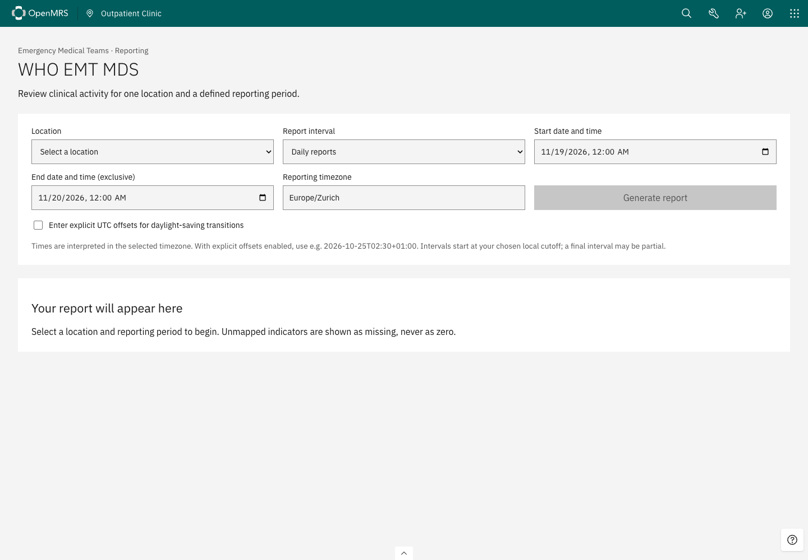
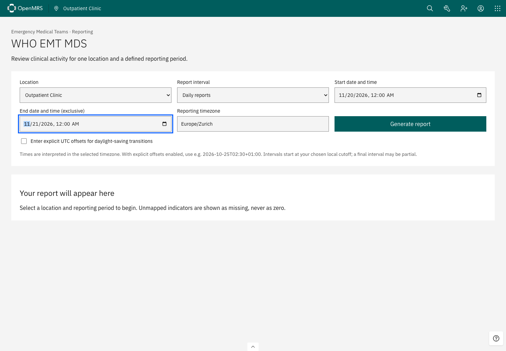
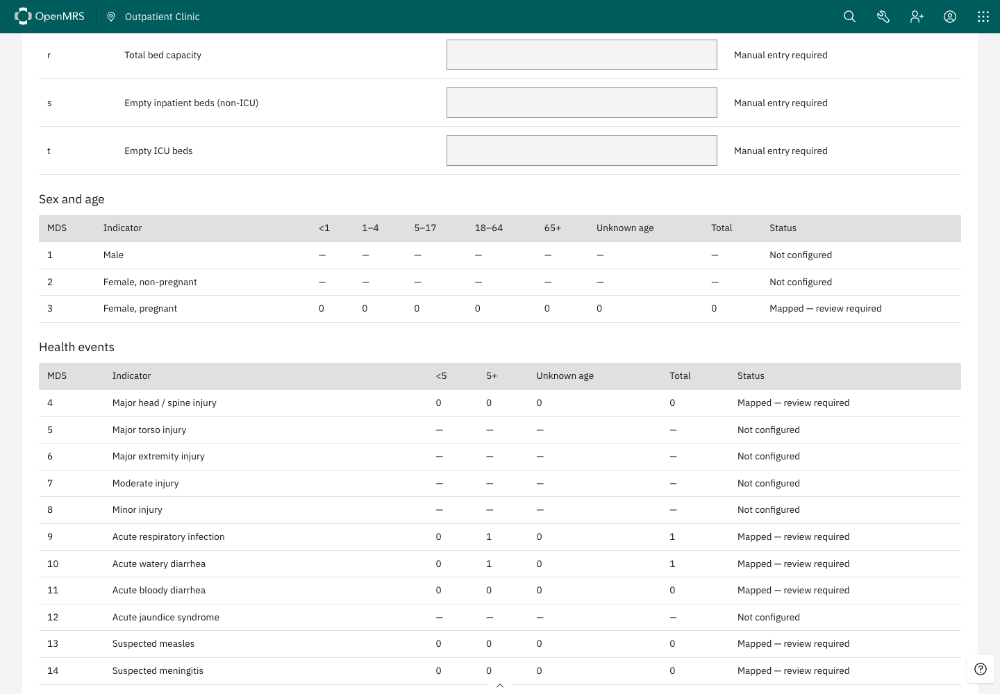
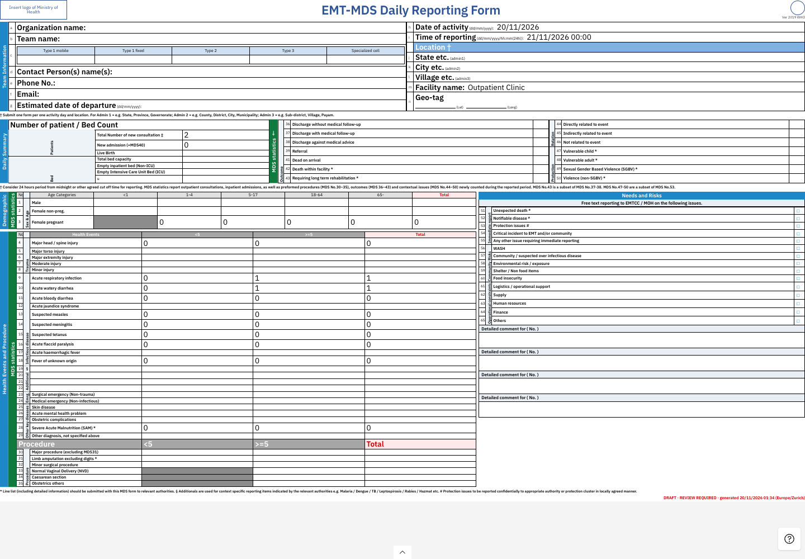

# Walkthrough: from a patient visit to a mapped MDS report

This guide goes end to end on a local OpenMRS 3 reference-application stack: sign in, record a
patient visit and a diagnosis, then generate the WHO EMT MDS report and see those entries counted
against MDS indicator rows.

Everything below was executed against a live instance (Platform 2.8.10, Core 11.0.0) and the
screenshots are of that run. The sample mapping used here is
[`config/mappings.sample-demo.json`](../config/mappings.sample-demo.json), which is a demonstration
set, **not** a validated EMT case-definition set — see [Caveats](#caveats).

## Prerequisites

- The Compose stack running, with the `whomds` module started and the frontend app registered
  (see [Install locally](../README.md#install-locally)).
- The sample mapping loaded into the `whomds.mappings` global property
  (see [Sample mapping](../README.md#sample-mapping-demo-database)).
- A reporting user holding `Run WHO MDS Reports`, a location grant, and `Get Diagnoses`
  (see [Permissions](../README.md#permissions)).

## 1. Open the reporting app

Sign in to OpenMRS at `http://localhost/openmrs` and pick a login location. Then open the app menu
(the grid icon, top left) and choose **WHO EMT MDS**, or go straight to:

```
http://localhost/openmrs/spa/who-mds
```

The report filters appear with no data yet. Unmapped indicators will be shown as missing, never as
zero.



> **If the menu entry is missing:** the O3 route guard compares against the signed-in user's
> privilege list literally. `System Developer` is a superuser bypass that reports an *empty*
> privilege list, so the page stays hidden until `Run WHO MDS Reports` is granted explicitly to a
> role the user actually holds.

## 2. Record a patient visit

The report counts clinical activity, so there must be some. In a separate tab:

1. Search for a patient from the demo data (this walkthrough used **Joshua Johnson**, identifier
   `100008E`) and open their chart.
2. Choose **Start a visit**, pick a visit type such as **Facility Visit**, and save.

## 3. Record an encounter with a diagnosis

In the patient chart, open the **Visit note** workspace and record:

- a **diagnosis** — this walkthrough used *Acute respiratory infection* and *Acute diarrhea*
- then **Save and close**.

This creates a `Visit Note` encounter plus a coded diagnosis. Repeat it to get a second encounter if
you want a count above one.

Two things here decide whether the report can see the entry, and both are easy to get wrong:

| What | Why it matters |
| --- | --- |
| **Encounter location** | The module filters on the **encounter** location, *not* the visit location. In this walkthrough the visit was at `Ubuntu Hospital` while the encounters were at `Outpatient Clinic`; reporting on `Ubuntu Hospital` returned **no** rows, and `Outpatient Clinic` returned the data. Child locations are never included implicitly. |
| **Coded, not free text** | The diagnosis must be chosen from the search results so it is stored as a coded concept. Free-text diagnoses are never counted. |

Where the diagnosis is stored is the reason this module needs its own mapping source: O3's diagnosis
widget writes to the `encounter_diagnosis` table, not to coded observations. The
`encounterDiagnosis` source reads that table (see
[Clinical mapping](../README.md#clinical-mapping)).

## 4. Generate the report

Back in **WHO EMT MDS**, set the filters to the day you just recorded activity for:

| Field | Value used here |
| --- | --- |
| Location | `Outpatient Clinic` |
| Report interval | `Daily reports` |
| Start date and time | `2026-11-20, 12:00 AM` |
| End date and time (exclusive) | `2026-11-21, 12:00 AM` |
| Reporting timezone | `Europe/Zurich` |



**Watch the AM/PM.** The end time is *exclusive*, and intervals are anchored to your chosen start,
not to midnight. An end of `12:00 PM` instead of `12:00 AM` makes a 36-hour range, which on daily
frequency is **two** intervals — and the printed output emits one page per interval, so you get two
pages with the first one likely empty. For a single day, keep start and end exactly 24 hours apart.

Select **Generate report**.

## 5. Read the mapped result

The report renders with a `DRAFT · REVIEW REQUIRED` banner. The diagnoses entered in step 3 are now
counted against MDS rows, broken down by age band:


For the run shown above:

| MDS | Indicator | Count | Status |
| --- | --- | --- | --- |
| `o` | New consultations | 2 | Mapped — review required |
| `9` | Acute respiratory infection | 1 (`5+`) | Mapped — review required |
| `10` | Acute watery diarrhea | 1 (`5+`) | Mapped — review required |



### Reading the status column

This is the part worth understanding, because the module deliberately refuses to let a blank look
like a real zero:

| Status | Meaning |
| --- | --- |
| `Mapped — review required` | A reviewed mapping ran. The count is real, but still needs human review. |
| `Not configured` | No mapping exists for this row. Shown as `—`, never `0`. |
| `Mapping not reviewed` | A mapping exists but has `reviewed: false`, so it was **not** run. |
| `Manual entry required` | Bed snapshots (`r`–`t`) and needs/risks (`51`–`65`); type these in. |

A mapped `0` means "nothing matched the mapping", **not** "this did not happen clinically". Row `3`
(female, pregnant) counts `0` in this walkthrough because the demo database contains no
`Pregnancy status` observation at all — not because no pregnant patients presented.

## 6. Add manual sections and export

Fill in **Team and deployment information**, the **Bed snapshot** rows (record these at the period
end) and any **Needs and risks** items. These are included in the CSV and the printed form but are
**not saved to OpenMRS** — they live in the page only, so finish the export before reloading.

Then either:

- **Download review CSV** — a review export, *not* the official eDATA submission format.
- **Print / save PDF** — reproduces the official WHO EMT-MDS Daily Reporting Form (Ver 2019), one
  page per reporting interval.



Do not enter patient identifiers in the narrative fields; use the agreed confidential reporting
pathway for protection details.

## Caveats

These are properties of this walkthrough and the demo database, not bugs:

- **The groupings are illustrative.** The demo database holds randomly generated CIEL diagnoses, so
  the sample mapping demonstrates the *mechanism*, not clinically agreed case definitions. Validate
  definitions with the deployment team before use.
- **`o` (new consultations) is a demo proxy.** It maps to the `Visit Note` encounter type, which does
  not distinguish new consultations from follow-ups. A real deployment needs an encounter type that
  does.
- **Row `42` (death within facility) is intentionally unmapped**, with `reviewed: false`, so it
  reports `Mapping not reviewed`. Discharge encounters are not a valid death mapping.
- **All output is DRAFT.** Weekly output is a period summary, not the official daily submission.

## Troubleshooting

| Symptom | Cause |
| --- | --- |
| Two printed pages, first one empty | The range spans more than one interval — usually `12:00 PM` typed instead of `12:00 AM`. See step 4. |
| Report returns counts of `0` for everything | Reporting on the **visit** location rather than the **encounter** location, or the wrong day. See step 3. |
| Every row says `Not configured` | The `whomds.mappings` global property is empty or was not saved. |
| A row says `Mapping not reviewed` | That mapping has `reviewed: false`. This is deliberate for row `42`. |
| App menu entry missing | `Run WHO MDS Reports` not granted explicitly to a role the user holds. See step 1. |
| HTTP 400 on generate | Ambiguous or nonexistent local time (a DST gap or overlap). Use an explicit UTC offset, or a cutoff outside the transition hour. |
| HTTP 403 mentioning a clinical read privilege | The user lacks `Get Diagnoses` (needed by `encounterDiagnosis` mappings) or another read privilege. |
